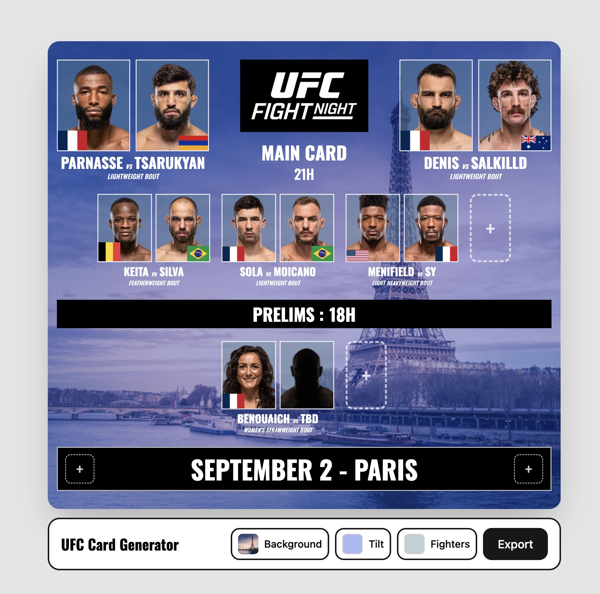

# MMA Card Generator

Build a UFC-style fight card poster in your browser: pick fighters, set the event, the date and the background, then export it as a PNG.



**👉 Try it: [anisg.github.io/mma-card-generator](https://anisg.github.io/mma-card-generator/)**

## Features

- 700+ current UFC fighters with photos and flags, searchable and filterable by weight class and country
- Main card (up to 6 fights) and optional prelims (up to 8)
- Fight Night or numbered event logo, editable date and times
- Background from a gallery of UFC host cities or your own image
- Undo / redo (⌘Z / ⌘⇧Z)
- PNG export

## Run locally

```bash
npm install --legacy-peer-deps
npm run dev
```

## Known issues

- **Compound last names are split incorrectly.** The card shows the last word of the full name, so "Benoît Saint Denis" becomes "DENIS" instead of "SAINT DENIS" (same for names like "Rafael dos Anjos" or "Reinier de Ridder", and Asian names written family-name first, e.g. "Song Yadong" → "YADONG"). Fix: store first name and last name separately in `data/fighters.json` instead of deriving them from the full name.
